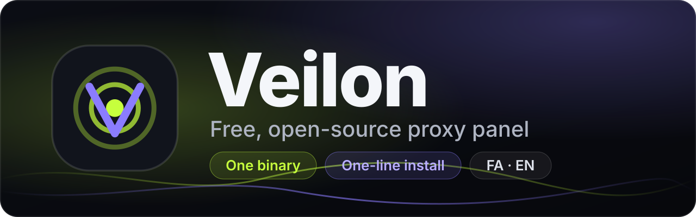
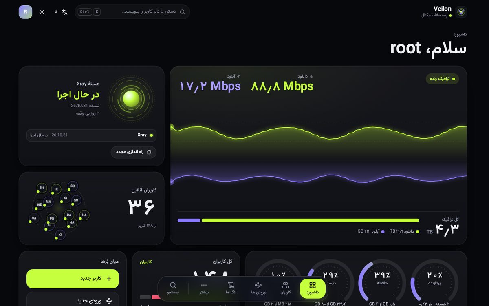
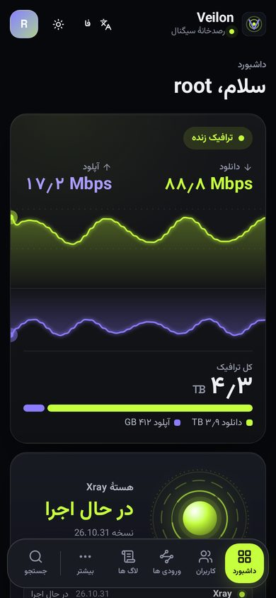
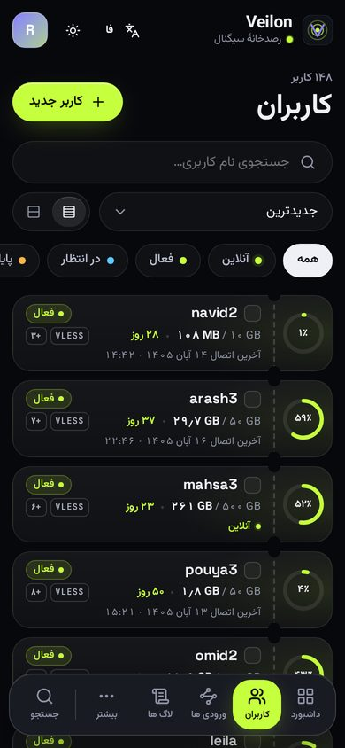
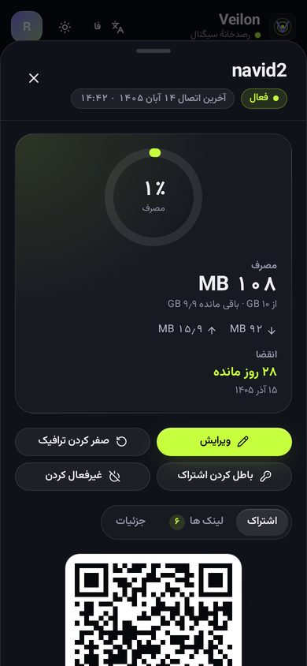
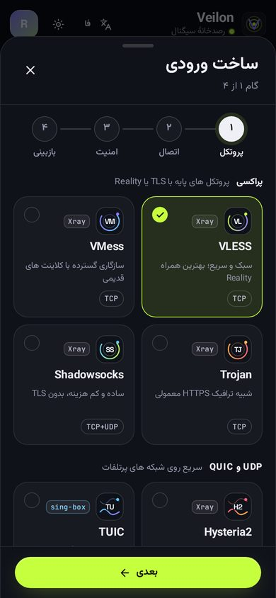

<p align="center">
  
</p>

<p align="center">
  <a href="https://github.com/veilonhq/veilon/releases/latest"></a>
  <a href="LICENSE"></a>
  <a href="go.mod"></a>
  
  <a href="https://github.com/veilonhq/veilon/releases"></a>
</p>

<p align="center">
  <a href="#fa"><b>فارسی</b></a>
  &nbsp;·&nbsp;
  <a href="#english"><b>English</b></a>
</p>

---

<a id="fa"></a>

<div dir="rtl">

<div align="center">

# Veilon

**توسعه داده شده توسط &lrm;[@lxhosein](https://t.me/lxhosein)**

پنل مدیریت پروکسی رایگان؛ یک فایل اجرایی، نصب با یک دستور

📱 [کلاینت اندروید Veilon](https://github.com/veilonhq/veilon/tree/feat/client/client)
&nbsp;·&nbsp;
🔍 [اسکنر DNS و IP (ScanON)](https://github.com/skylarsob/ScanON)
&nbsp;·&nbsp;
📢 [کانال تلگرام](https://t.me/veilon2)

</div>

Veilon یک پنل مدیریت پروکسی رایگان است. یک فایل اجرایی Go همه کار را انجام می دهد: رابط وب، API، لینک اشتراک (Subscription) و مدیریت هسته های پروکسی. نصب با یک دستور انجام می شود و رابط کاربری فارسی و انگلیسی دارد.

<table>
  <tr>
    <td width="50%" valign="top">⚡ <b>یک فایل اجرایی</b><br><sub>رابط وب، API، لینک اشتراک و هسته ها در یک برنامه Go</sub></td>
    <td width="50%" valign="top">🚀 <b>نصب با یک دستور</b><br><sub>روی Ubuntu، Debian، CentOS Stream، AlmaLinux، Rocky Linux، Fedora و Arch</sub></td>
  </tr>
  <tr>
    <td valign="top">🧩 <b>۱۸ پروتکل</b><br><sub>از VLESS و Reality تا Hysteria2، TUIC، WireGuard و AmneziaWG</sub></td>
    <td valign="top">🔒 <b>SSL رایگان</b><br><sub>Let's Encrypt برای دامنه یا مستقیم برای IP سرور، با تمدید خودکار</sub></td>
  </tr>
  <tr>
    <td valign="top">👥 <b>مدیریت کامل کاربران</b><br><sub>سقف حجم، انقضا، محدودیت IP و دستگاه، گروه ها و چند مدیر</sub></td>
    <td valign="top">🌗 <b>فارسی و انگلیسی</b><br><sub>رابط واکنش گرا برای موبایل و دسکتاپ، تم تیره و روشن</sub></td>
  </tr>
</table>

### ⚡ نصب سریع

```bash
bash <(curl -Ls https://raw.githubusercontent.com/veilonhq/veilon/main/installer/install.sh)
```

<sub>تازه کار هستید؟ <a href="#نصب-قدم-به-قدم-برای-تازه-کارها">راهنمای نصب قدم به قدم</a> را ببینید.</sub>

## فهرست

- [نمای پنل](#نمای-پنل)
- [امکانات](#امکانات)
- [پروتکل ها](#پروتکل-ها)
- [پیش نیازها](#پیش-نیازها)
- [نصب قدم به قدم برای تازه کارها](#نصب-قدم-به-قدم-برای-تازه-کارها)
- [باز کردن پورت ها در فایروال](#باز-کردن-پورت-ها-در-فایروال)
- [گواهی SSL: دامنه یا IP سرور](#گواهی-ssl-دامنه-یا-ip-سرور)
- [اولین ورود، ساخت ورودی و کاربر](#اولین-ورود-ساخت-ورودی-و-کاربر)
- [اتصال با برنامه های کلاینت](#اتصال-با-برنامه-های-کلاینت)
- [پیکربندی Xray، هاست ها، به روزرسانی و نودها](#پیکربندی-xray-هاست-ها-به-روزرسانی-و-نودها)
- [منوی مدیریت veilon](#منوی-مدیریت-veilon)
- [رفع مشکلات رایج](#رفع-مشکلات-رایج)
- [حمایت از توسعه دهنده](#حمایت-از-توسعه-دهنده)
- [مجوز](#مجوز)

---

## نمای پنل

<p align="center">
  
</p>

<p align="center">   </p>

## امکانات

- 🧩 **پروتکل ها:** VLESS، VMess، Trojan، Shadowsocks (شامل 2022)، Hysteria2 (با پرش پورت)، TUIC، ShadowTLS، AnyTLS، NaiveProxy، WireGuard، AmneziaWG، HTTP، Mixed (HTTP + SOCKS)، SOCKS، Tunnel، TUN، MTProto و MASQUE
- 🛡️ **امنیت اتصال:** Reality و TLS، انتقال TCP، WebSocket، gRPC، HTTPUpgrade و XHTTP
- 🔒 **گواهی رایگان Let's Encrypt:** برای دامنه (۹۰ روزه) یا مستقیم برای IP سرور (کوتاه مدت)، با تمدید خودکار
- 👥 **مدیریت کاربران:** سقف حجم، تاریخ انقضا، شروع انقضا از اولین اتصال، ریست دوره ای حجم (روزانه، هفتگی، ماهانه)، وضعیت آنلاین و آخرین اتصال، عملیات گروهی
- 🔗 **لینک اشتراک:** برای v2rayNG، Hiddify، Streisand، sing-box و Clash، به همراه کد QR و فایل `.conf` برای WireGuard و AmneziaWG
- 🧭 **ورودی ها (Inbounds):** ساخت با راهنمای مرحله به مرحله؛ پورت و نام هر ورودی یکتاست و پنل همان لحظه هشدار می دهد
- 📊 **داشبورد زنده:** ترافیک لحظه ای واقعی کارت شبکه، کاربران آنلاین، مصرف CPU، حافظه و دیسک؛ مجموع ترافیک برابر با جمع مصرف کاربران است
- ⚙️ **کنترل هسته Xray از داشبورد:** روشن و خاموش کردن هسته (خاموش بودن بعد از ری استارت پنل هم می ماند)، انتخاب و نصب هر نسخه Xray از لیست نسخه های رسمی (با بررسی فایل و برگشت خودکار در صورت خطا) و به روزرسانی فایل های geo
- 🕒 **منطقه زمانی پنل:** همه تاریخ ها، نمودارها، ریست های دوره ای و بازه های زمانی کاربران به وقت منطقه زمانی انتخابی در تنظیمات (مثلا تهران؛ پیش فرض UTC)
- 📜 **لاگ ها:** لاگ Xray، هسته های دیگر و خود پنل، جدا یا همه با هم، با زمان دقیق هر خط و سطح (info، warning، error)
- 🚦 **محدودیت های هر کاربر:** تعداد IP همزمان، تعداد دستگاه (HWID)، سرعت دانلود و آپلود جدا، سقف حجم روزانه، ضریب مصرف، مسدود کردن تورنت، بازه زمانی مجاز (ساعت و روزهای هفته به وقت منطقه زمانی پنل)؛ برای TUIC هم کار می کند
- 🔍 **گزارش اتصال ها:** IP ها و دستگاه های هر کاربر با اولین و آخرین زمان دیده شدن، و مسدود یا آزاد کردن هر IP یا دستگاه
- 🗂️ **گروه ها:** گروه بسازید، کاربران را در گروه بگذارید، برای گروه ورودی ها و مقادیر پیش فرض تعیین کنید و مسدودسازی تبلیغات را روشن کنید
- 🧑‍💼 **چند مدیر با دسترسی جدا:** مدیر اصلی و مدیران زیرمجموعه؛ برای هر مدیر دیدن، ساختن، ویرایش و حذف کاربران و دسترسی به بخش ها جدا روشن یا خاموش می شود، به همراه سقف تعداد کاربر و حجم؛ ثبت رویدادها (Audit log)
- 🧭 **پیکربندی Xray:** خروجی ها، قوانین مسیریابی، متعادل کننده ها، DNS و ویرایشگر JSON؛ هر تغییر قبل از اعمال توسط خود Xray بررسی می شود و در صورت خطا پیکربندی قبلی برمی گردد
- 🌐 **هاست ها:** برای هر ورودی چند لینک با آدرس، پورت، SNI یا مسیر دیگر (مثلا CDN یا دامنه دیگر) در اشتراک کاربران
- 🔄 **به روزرسانی از داخل پنل:** اعلان نسخه تازه، بررسی checksum، پشتیبان برنامه و پایگاه داده، و برگشت خودکار اگر نسخه تازه سالم بالا نیاید
- 🛰️ **نودها (اختیاری):** سرورهای دیگر با همان کاربران، با ارتباط mTLS، ارسال خودکار پیکربندی و وضعیت هر نود؛ برای هر ورودی انتخاب می کنید روی سرور اصلی اجرا شود یا روی نودها؛ محدودیت IP و سرعت روی همه سرورها؛ ترافیک به تفکیک هر سرور
- 🗄️ **پایگاه داده:** PostgreSQL (پیش فرض) یا SQLite
- 💻 **منوی خط فرمان `veilon`:** به روزرسانی، ری استارت، لاگ ها، تغییر رمز، پورت، مسیر، SSL، BBR و فایروال
- 🌗 **رابط کاربری:** واکنش گرا برای موبایل و دسکتاپ، تم تیره و روشن، فارسی (پیش فرض) و انگلیسی

## پروتکل ها

| گروه | پروتکل ها | کاربرد |
| --- | --- | --- |
| 🛡️ **پراکسی** | VLESS، VMess، Trojan، Shadowsocks (شامل 2022) | پروتکل های پایه با TLS یا Reality |
| 🎭 **استتار TLS** | ShadowTLS، AnyTLS، NaiveProxy | شبیه ترافیک عادی HTTPS (با sing-box، روی سرور اصلی) |
| ⚡ **UDP و QUIC** | Hysteria2، TUIC، MASQUE | سریع روی شبکه های پرتلفات |
| 🌐 **VPN** | WireGuard، AmneziaWG، TUN | تونل کامل لایه شبکه |
| 🔧 **ابزاری** | HTTP، Mixed (HTTP + SOCKS)، SOCKS، Tunnel، MTProto | پراکسی ساده، پورت فوروارد و تلگرام |

**امنیت:** Reality و TLS &nbsp;·&nbsp; **انتقال:** TCP، WebSocket، gRPC، HTTPUpgrade و XHTTP

## پیش نیازها

| مورد | نیاز |
| --- | --- |
| 🖥️ **سرور** | یک سرور مجازی (VPS) لازم است |
| 🐧 **سیستم عامل** | Ubuntu، Debian، CentOS Stream، AlmaLinux، Rocky Linux، Fedora یا Arch Linux، با systemd (پیشنهاد: Ubuntu 22.04 یا 24.04، یا Debian 12) |
| 🧠 **پردازنده** | معماری amd64 (x86_64) یا arm64، حداقل ۱ هسته |
| 💾 **رم** | حداقل ۱ گیگابایت (۲ گیگابایت پیشنهاد می شود) |
| 🔑 **دسترسی** | دسترسی root (یا کاربری که بتواند `sudo` بزند) |
| 🌍 **اختیاری** | یک دامنه که رکورد DNS آن به IP سرور اشاره کند |

---

## نصب قدم به قدم برای تازه کارها

### ۱. تهیه سرور

یک سرور مجازی (VPS) لازم است، با یکی از سیستم عامل های بخش پیش نیازها (پیشنهاد: **Ubuntu 24.04** یا **Debian 12**)، حداقل ۱ هسته پردازنده amd64 یا arm64 و حداقل ۱ گیگابایت رم. بعد از تحویل سرور این اطلاعات را دارید:

- **IP سرور** (مثلا `203.0.113.10`)
- **نام کاربری** (معمولا `root`)
- **رمز عبور**

### ۲. اتصال به سرور با SSH

روش اصلی ورود با رمز عبور است:

```bash
ssh root@SERVER_IP
```

به جای `SERVER_IP`، IP سرور خودتان را بنویسید (مثلا `ssh root@203.0.113.10`). بار اول سوال `Are you sure you want to continue connecting` می آید؛ `yes` را تایپ کنید و Enter بزنید. سپس رمز عبور را وارد کنید و Enter بزنید. هنگام تایپ رمز چیزی روی صفحه نمایش داده نمی شود؛ این طبیعی است.

<details>
<summary><b>🪟 ویندوز، 🤖 اندروید، 🍎 macOS و 🐧 Linux</b></summary>

<br>

**ویندوز (PowerShell):** کلید Windows را بزنید، `PowerShell` را تایپ و باز کنید و دستور بالا را بزنید.

**ویندوز با Termius:** اگر محیط گرافیکی را ترجیح می دهید، برنامه Termius را نصب کنید و مثل بخش اندروید جلو بروید.

**اندروید (Termius):** برنامه Termius را از Google Play نصب کنید، روی **New Host** بزنید، IP سرور را در **Address**، `root` را در **Username** و رمز را در **Password** وارد کنید و **Connect** را بزنید.

**macOS و Linux:** برنامه Terminal را باز کنید و همان دستور بالا را بزنید.

</details>

<details>
<summary><b>🔑 اختیاری: ورود با فایل کلید</b></summary>

<br>

اگر به جای رمز، یک فایل کلید به شما داده شده است:

```bash
ssh -i key root@SERVER_IP
```

به جای `key` مسیر فایل کلید را بنویسید. در macOS و Linux اگر خطای دسترسی فایل دیدید، اول `chmod 600 key` را بزنید. در Termius فایل کلید را در بخش **Keys** اضافه کنید و برای Host انتخاب کنید.

</details>

### ۳. کاربر root شوید

اگر با کاربری غیر از root وارد شده اید:

```bash
sudo -i
```

### ۴. اجرای دستور نصب

```bash
bash <(curl -Ls https://raw.githubusercontent.com/veilonhq/veilon/main/installer/install.sh)
```

برای نصب یک نسخه مشخص:

```bash
bash <(curl -Ls https://raw.githubusercontent.com/veilonhq/veilon/main/installer/install.sh) v0.3.9
```

اگر `curl` نصب نیست:

```bash
apt update && apt install -y curl
```

### ۵. سوال های نصب و پاسخ پیشنهادی

نصب کننده چند سوال می پرسد. برای قبول مقدار پیش فرض فقط Enter بزنید.

| سوال | معنی | پیشنهاد |
| --- | --- | --- |
| `Panel port` | پورتی که پنل روی آن باز می شود | Enter (یک پورت تصادفی و آزاد انتخاب می شود) |
| `Admin username` | نام کاربری مدیر پنل | Enter (`admin`) یا یک نام دلخواه |
| `Admin password` | رمز مدیر | Enter (رمز قوی تصادفی ساخته می شود) |
| `Panel path` | مسیر مخفی پنل در آدرس | Enter (مسیر تصادفی؛ امنیت را بالا می برد) |
| `Panel certificate` | نوع گواهی HTTPS | `1` اگر دامنه دارید، `2` اگر ندارید (IP سرور) |
| `Domain` | فقط در گزینه ۱: دامنه شما | مثلا `panel.example.com` |
| `IP address for the certificate` | فقط در گزینه ۲: IP تشخیص داده شده | Enter برای تایید |

نصب کننده PostgreSQL، هسته Xray و سرویس systemd را نصب و راه اندازی می کند.

### ۶. آدرس، نام کاربری و رمز پنل

در پایان، آدرس پنل، نام کاربری و رمز نمایش داده می شود؛ مثلا:

```
URL:      https://203.0.113.10:24871/abcdefghijklmnop/
Username: admin
Password: ••••••••••••••••
```

این اطلاعات در فایل زیر هم ذخیره می شود:

```bash
cat /root/veilon-credentials.txt
```

> 💡 اجرای دوباره همان دستور نصب روی سروری که Veilon دارد، آن را **به روزرسانی** می کند و اطلاعات و تنظیمات حفظ می شود.

---

## باز کردن پورت ها در فایروال

این پورت ها باید از اینترنت در دسترس باشند:

- **پورت پنل** (همان که در نصب انتخاب شد)
- **پورت 80/tcp** برای صدور و تمدید گواهی Let's Encrypt
- **پورت هر ورودی** که می سازید (مثلا 443)

پورت پنل را در فایروال سرور باز کنید، و اگر ارائه دهنده سرور شما در پنل خودش فایروال دارد، آنجا هم باز کنید. برای Hysteria2، TUIC و WireGuard پورت ورودی باید به صورت UDP باز باشد. اگر برای Hysteria2 پرش پورت روشن کرده اید، کل بازه UDP آن را هم باز کنید.

ساده ترین راه برای فایروال داخل سرور (ufw یا firewalld):

```bash
veilon firewall
```

<details>
<summary><b>باز کردن دستی پورت ها با ufw یا firewalld</b></summary>

<br>

با **ufw** (Ubuntu و Debian). به جای `PANEL_PORT` پورت پنل را بنویسید:

```bash
ufw allow PANEL_PORT/tcp
ufw allow 80/tcp
ufw allow 443/tcp
ufw reload
```

با **firewalld** (CentOS Stream، AlmaLinux، Rocky Linux، Fedora):

```bash
firewall-cmd --permanent --add-port=PANEL_PORT/tcp
firewall-cmd --permanent --add-port=80/tcp
firewall-cmd --permanent --add-port=443/tcp
firewall-cmd --reload
```

برای پورت UDP، به جای `tcp` بنویسید `udp` (مثلا `ufw allow 8443/udp`).

</details>

## گواهی SSL: دامنه یا IP سرور

| گزینه | گواهی | توضیح |
| --- | --- | --- |
| **۱. دامنه** | Let's Encrypt، ۹۰ روزه، تمدید خودکار | قبل از نصب، یک رکورد `A` برای دامنه بسازید که به IP سرور اشاره کند (اگر سرویس DNS شما گزینه پروکسی یا CDN دارد، آن را برای این رکورد خاموش کنید) |
| **۲. IP سرور** | Let's Encrypt کوتاه مدت (حدود ۶ روز) مستقیم برای IP | هر ۳ روز خودکار تمدید می شود. نیازی به دامنه نیست |
| **۳. رد کردن** | بدون گواهی | پنل با HTTP ساده باز می شود و بعدا می توانید از منو گواهی بگیرید |

گرفتن یا تغییر گواهی بعد از نصب:

```bash
veilon cert issue --domain panel.example.com --panel
```

```bash
veilon cert issue --ip auto --panel
```

```bash
veilon cert list
```

در هر دو حالت پورت 80/tcp باید باز باشد.

---

## اولین ورود، ساخت ورودی و کاربر

1. آدرس پنل را در مرورگر باز کنید و با نام کاربری و رمز وارد شوید.
2. **ساخت ورودی:** به بخش **ورودی ها** بروید ← **ورودی جدید**. برای شروع **VLESS + Reality** پیشنهاد می شود: پروتکل VLESS، انتقال tcp، امنیت Reality، پورت 443. کلیدهای Reality خودکار ساخته می شوند. وارد کردن پورت الزامی است و پورت و نام هر ورودی باید یکتا باشد؛ اگر تکراری باشد، پنل همان لحظه هشدار می دهد.
3. **ساخت کاربر:** به بخش **کاربران** بروید ← **کاربر جدید**. نام، سقف حجم (۰ یعنی نامحدود)، تاریخ انقضا و ورودی هایی که کاربر به آن ها دسترسی دارد را انتخاب کنید.
4. روی کاربر بزنید تا **لینک اشتراک**، **کد QR** و لینک های تکی را ببینید.

<details>
<summary><b>قدم های بعدی: محدودیت ها، گروه ها، مدیران، TUIC، هسته Xray، منطقه زمانی و لاگ ها</b></summary>

<br>

5. **محدودیت ها (اختیاری):** در فرم کاربر، بخش محدودیت ها را باز کنید. مثلا «IP همزمان» را ۲ بگذارید تا کاربر فقط با دو IP همزمان وصل شود، یا سرعت دانلود را محدود کنید. هر مقدار ۰ یعنی بدون محدودیت. در زبانه **اتصال ها** IP ها و دستگاه های کاربر را می بینید و می توانید هر کدام را مسدود کنید.
6. **گروه ها (اختیاری):** در بخش **گروه ها** یک گروه بسازید، ورودی ها و مقادیر پیش فرض آن را تعیین کنید و هنگام ساخت کاربر، گروه را انتخاب کنید.
7. **مدیران (اختیاری):** در بخش **مدیران** مدیر جدید بسازید و برای او مشخص کنید چه کارهایی مجاز است (مثلا فقط دیدن کاربران). دکمه هایی که مدیر اجازه آن را ندارد در پنل نمایش داده نمی شوند. مدیری که هنوز کاربر دارد حذف نمی شود؛ اول کاربرانش را منتقل یا حذف کنید.
8. **TUIC:** در ورودی جدید پروتکل TUIC را انتخاب کنید (به گواهی TLS نیاز دارد، بخش SSL را ببینید). محدودیت های کاربر برای TUIC هم اعمال می شوند.
9. **هسته Xray:** در کارت هسته در **داشبورد** می توانید هسته را خاموش و روشن کنید، روی شماره نسخه بزنید و نسخه دیگری نصب کنید، یا فایل های geo را به روز کنید.
10. **منطقه زمانی:** در **تنظیمات** منطقه زمانی پنل را انتخاب کنید (مثلا تهران؛ پیش فرض UTC). زمان لاگ ها، نمودار ترافیک و ریست های روزانه، هفتگی و ماهانه طبق آن است.
11. **لاگ ها:** در بخش **لاگ ها** منبع را انتخاب کنید (Xray، پنل یا همه) تا هر خط را با زمان دقیق ببینید.

</details>

## اتصال با برنامه های کلاینت

| برنامه | سیستم عامل | روش |
| --- | --- | --- |
| **[Veilon Client](https://github.com/veilonhq/veilon/tree/feat/client/client)** | اندروید | کلاینت رسمی Veilon: لینک اشتراک را با دکمه + وارد کنید یا QR را اسکن کنید |
| **v2rayNG** | اندروید | لینک اشتراک را کپی کنید ← دکمه + ← Import from clipboard؛ یا کد QR را اسکن کنید |
| **Hiddify** | اندروید، iOS، ویندوز، macOS، لینوکس | New Profile ← لینک اشتراک را وارد کنید |
| **Streisand** | iOS و macOS | دکمه + ← لینک اشتراک یا اسکن QR |
| **AmneziaWG** | اندروید، iOS، ویندوز، macOS | برای ورودی های AmneziaWG: فایل `.conf` را از صفحه کاربر دانلود کنید و در برنامه Import from file بزنید |
| **WireGuard** | همه | برای ورودی های WireGuard: فایل `.conf` یا اسکن QR |

لینک اشتراک خودکار به روز می شود؛ اگر ورودی جدیدی به کاربر بدهید، کافی است در برنامه Update subscription را بزنید.

## ابزار پیشنهادی: ScanON

اگر دنبال DNS یا IP تمیز هستید، [ScanON](https://github.com/skylarsob/ScanON) یک اپ اندرویدی برای کاربرهای ایران است که IP، DNS و دامنه را اسکن می کند و نتیجه واقعی و تایید شده می دهد.

- اسکن DNS با UDP، TCP، DoT و DoH
- تست TCP، HTTP، HTTPS، WebSocket، ICMP و سرعت دانلود
- موقعیت و ASN هر IP

راهنما و دانلود: https://skylarsob.github.io/ScanON/

---

## پیکربندی Xray، هاست ها، به روزرسانی و نودها

- **پیکربندی Xray:** در **بیشتر ← پیکربندی Xray** خروجی ها، قوانین مسیریابی، متعادل کننده ها و DNS هسته را تنظیم کنید. **آزمایش** پیکربندی را با خود Xray بررسی می کند و **اعمال** آن را با برگشت خودکار در صورت خطا اجرا می کند. [راهنما](docs/fa/xray-config.md)
- **هاست ها:** در **ورودی ها** روی دکمه هاست ها در ردیف هر ورودی بزنید تا لینک های اضافه (CDN، دامنه یا پورت دیگر) بسازید. فیلدهای خالی همان مقدار ورودی را نگه می دارند. [راهنما](docs/fa/hosts.md)
- **به روزرسانی از داخل پنل:** وقتی نسخه تازه بیاید، بالای پنل اعلان نمایش داده می شود و با **نصب به روزرسانی** نصب می شود. سرورهایی که نسخه v0.2.2 یا قدیمی تر دارند باید یک بار دستور نصب را دوباره روی سرور اجرا کنند (اطلاعات می ماند). [راهنما](docs/fa/self-update.md)
- **نودها (اختیاری):** برای پنل فقط یک VPS لازم است. اگر سرور دیگری دارید، در **بیشتر ← نودها ← افزودن نود** آن را اضافه کنید و دستوری را که پنل نشان می دهد روی سرور نود اجرا کنید (به شکل `install.sh node --token ...`). [راهنما](docs/fa/nodes.md)
- **ربات تلگرام (اختیاری):** در **بیشتر ← ربات تلگرام** توکن ربات را از @BotFather و شناسه عددی مدیران را وارد کنید تا پنل را از تلگرام مدیریت کنید و اعلان حجم و انقضای کاربران، قطع شدن نودها و نسخه تازه را بگیرید. [راهنما](docs/fa/telegram-bot.md)
- **SOCKS و ورود پراکسی دلخواه:** ورودی SOCKS5 تنها (با رمز یا بدون احراز هویت)، و برای هر کاربر نام کاربری و رمز دلخواه روی ورودی های HTTP، Mixed و SOCKS در فرم کاربر. [راهنما](docs/fa/socks-proxy-login.md)
- **فایروال هر کاربر:** فهرست دامنه ها و IP هایی که فقط برای یک کاربر بسته می شوند، در فرم کاربر، ربات تلگرام و API. [راهنما](docs/fa/user-firewall.md)
- **رمزگذاری VLESS:** لایه رمزگذاری پساکوانتومی خود VLESS (X25519 یا ML-KEM-768، حالت native، xorpub یا random، 0-RTT یا 1-RTT) در فرم ورودی VLESS، با ساخت کلید در پنل، روی سرور اصلی و نودها. [راهنما](docs/fa/vless-encryption.md)
- **تنظیمات پیشرفته ورودی:** فال بک، ECH و نسخه ها و cipher های TLS، ML-DSA-65 در Reality، PROXY protocol و سوکت، تنظیمات اضافه XHTTP (padding، xmux، دانلود از CDN)، انتقال mKCP، Hysteria 2 (کنترل ازدحام و masquerade)، ماسک های fragment و noise، پروکسی معکوس VLESS (پل) و جزئیات شنود، در بخش بسته **تنظیمات پیشرفته** فرم ورودی. [راهنما](docs/fa/xray-advanced.md)
- **ShadowTLS، AnyTLS، NaiveProxy و پرش پورت:** سه پروتکل استتار TLS با sing-box روی سرور اصلی (NaiveProxy به گواهی یک CA واقعی نیاز دارد)، و پرش پورت Hysteria 2 روی سرور اصلی و نودها با nftables؛ بازه UDP را در فایروال سرویس دهنده ابری هم باز کنید. [راهنما](docs/fa/singbox-protocols.md)
  - **محل اجرا:** در فرم هر ورودی گزینه **محل اجرا** را می بینید: سرور اصلی یا یک یا چند نود. ورودی ای که روی نود است فقط روی همان نودها اجرا می شود و لینک کاربران به آدرس نود اشاره می کند. ورودی هایی که در نسخه های قبل به نود داده شده بودند روی سرور اصلی هم اجرا می مانند تا کاربران قطع نشوند (گزینه **روی سرور اصلی هم اجرا شود**).
  - **محدودیت IP روی همه سرورها:** IP های هر کاربر روی سرور اصلی و همه نودها با هم شمرده می شوند و IP های اضافه روی همه سرورها مسدود می شوند. برای این کار نودها باید برنامه نود را به روز کنند (در صفحه نودها **دستور نصب تازه** را بزنید و روی سرور نود اجرا کنید).
  - **ترافیک به تفکیک سرور:** داشبورد و صفحه نودها سهم هر سرور از ترافیک کاربران را نشان می دهند.

> **⚠️ هشدار:** پنل را روی سروری که نود است نصب نکنید. روی سرور نود فقط دستور نصب نود را اجرا کنید؛ نصب پنل و نود روی یک سرور باعث تداخل پورت ها و Xray می شود.

---

## منوی مدیریت veilon

با کاربر root این دستور را بزنید تا منوی مدیریت باز شود:

```bash
veilon
```

<details>
<summary><b>گزینه های منو</b></summary>

<br>

```
 1  Install / update            10  Status
 2  Uninstall                   11  Logs
 3  Reset username and password 12  Enable autostart
 4  Reset panel path            13  Disable autostart
 5  Change panel port           14  SSL certificates
 6  Show settings and URL       15  Enable BBR
 7  Start                       16  Firewall: open Veilon ports
 8  Stop                        17  Update geo files
 9  Restart                     18  Version
                                 0  Exit
```

</details>

همه گزینه ها به شکل دستور مستقیم هم هستند:

| کار | دستور |
| --- | --- |
| به روزرسانی | `veilon update` |
| ری استارت | `veilon restart` |
| وضعیت | `veilon status` |
| دیدن لاگ ها | `veilon logs -f` |
| آدرس و تنظیمات پنل | `veilon info` |
| تغییر نام کاربری و رمز | `veilon admin reset-credentials --username admin --password NEW_PASSWORD` |
| حذف یک مدیر | `veilon admin delete USERNAME` (آخرین مدیر کامل و مدیری که کاربر دارد حذف نمی شوند) |
| تغییر پورت پنل | `veilon set-port 2053` |
| تغییر مسیر پنل | `veilon set-path random` |
| تغییر زبان پیش فرض | `veilon set-language fa` یا `veilon set-language en` |
| گواهی ها | `veilon cert list` |
| فعال کردن BBR | `veilon bbr` |
| باز کردن پورت ها در فایروال | `veilon firewall` |
| حذف | `veilon uninstall` (با `--purge` اطلاعات و پایگاه داده هم حذف می شود) |

```bash
veilon help
```

مستندات API در [docs/api-v1.md](docs/api-v1.md) است.

## رفع مشکلات رایج

<details>
<summary><b>پنل باز نمی شود</b></summary>

<br>

1. وضعیت سرویس را ببینید: `veilon status`
2. آدرس دقیق را ببینید (پورت و مسیر را درست وارد کنید، با `/` آخر): `veilon info`
3. پورت پنل را در فایروال سرور، و اگر ارائه دهنده سرور شما در پنل خودش فایروال دارد آنجا هم، باز کنید.
4. لاگ ها را بررسی کنید: `veilon logs -n 100`

</details>

<details>
<summary><b>خطای گواهی یا «اتصال امن نیست»</b></summary>

<br>

- اگر گواهی نگرفته اید، آدرس با `http://` باز می شود نه `https://`.
- پورت 80/tcp باید باز باشد، سپس دوباره گواهی بگیرید: `veilon cert issue --ip auto --panel`
- برای دامنه، مطمئن شوید رکورد DNS به IP همین سرور اشاره می کند و پروکسی یا CDN سرویس DNS برای آن خاموش است.
- لیست و وضعیت گواهی ها: `veilon cert list`

</details>

<details>
<summary><b>رمز پنل را فراموش کرده ام</b></summary>

<br>

```bash
cat /root/veilon-credentials.txt
```

یا رمز تازه بسازید:

```bash
veilon admin reset-credentials --password NEW_PASSWORD
```

</details>

<details>
<summary><b>پورت در حال استفاده است</b></summary>

<br>

- پورت پنل: یک پورت دیگر بدهید: `veilon set-port 2096`
- پورت ورودی: پنل اجازه نمی دهد دو ورودی یک پورت داشته باشند. اگر برنامه دیگری روی سرور از آن پورت استفاده می کند، ببینید کدام است:

```bash
ss -tulpn | grep :443
```

</details>

<details>
<summary><b>کاربر وصل نمی شود</b></summary>

<br>

- پورت ورودی را در فایروال سرور، و اگر ارائه دهنده سرور شما در پنل خودش فایروال دارد آنجا هم، باز کنید (برای Hysteria2، TUIC و WireGuard به صورت UDP).
- ساعت گوشی و سرور باید درست باشد.
- در برنامه کلاینت Update subscription را بزنید.

</details>

---

## حمایت از توسعه دهنده

Veilon رایگان است و با وقت و علاقه ساخته می شود. اگر به کارتان آمده، هر حمایتی دلگرمی بزرگی است. همین اطلاعات در پنل، در منوی «بیشتر» ← «حمایت از توسعه دهنده» هم هست.

| مورد | جزئیات |
| --- | --- |
| 👛 **کیف پول** | Tonkeeper |
| 💎 **ارزها** | TON و تتر (USDT) **فقط روی شبکه TON** |

**آدرس:**

```
UQCr7FXmeLsKLplHAgb1HIT0rxmQJpvAh4w2pST-DBGicbi2
```

> ⚠️ هر ارز را فقط با شبکه مخصوص همان آدرس بفرستید؛ ارسال با شبکه دیگر باعث از دست رفتن پول می شود. تتر را از شبکه های TRC20، ERC20 یا BEP20 به این آدرس نفرستید.

## مجوز

همه حقوق محفوظ است. هیچ کس حق کپی، ویرایش، انتشار دوباره یا فروش این کد را ندارد. استفاده از نسخه های رسمی منتشر شده آزاد است. متن کامل در [LICENSE](LICENSE).

</div>

---

<a id="english"></a>

<div align="center">

# Veilon (English)

**Developed by &lrm;[@lxhosein](https://t.me/lxhosein)**

Free proxy panel. One binary, one-line install.

📱 [Veilon Android client](https://github.com/veilonhq/veilon/tree/feat/client/client)
&nbsp;·&nbsp;
🔍 [DNS & IP scanner (ScanON)](https://github.com/skylarsob/ScanON)
&nbsp;·&nbsp;
📢 [Telegram channel](https://t.me/veilon2)

</div>

Veilon is a free proxy panel. One Go binary serves the web UI, the API and subscriptions, and supervises the proxy cores. One-command install, Persian and English UI.

<table>
  <tr>
    <td width="50%" valign="top">⚡ <b>One binary</b><br><sub>Web UI, API, subscriptions and cores in a single Go program</sub></td>
    <td width="50%" valign="top">🚀 <b>One-line install</b><br><sub>Ubuntu, Debian, CentOS Stream, AlmaLinux, Rocky Linux, Fedora and Arch</sub></td>
  </tr>
  <tr>
    <td valign="top">🧩 <b>18 protocols</b><br><sub>From VLESS and Reality to Hysteria2, TUIC, WireGuard and AmneziaWG</sub></td>
    <td valign="top">🔒 <b>Free SSL</b><br><sub>Let's Encrypt for a domain or directly for the server IP, auto renewed</sub></td>
  </tr>
  <tr>
    <td valign="top">👥 <b>Full user management</b><br><sub>Data caps, expiry, IP and device limits, groups and multiple admins</sub></td>
    <td valign="top">🌗 <b>Persian and English</b><br><sub>Responsive UI for phone and desktop, dark and light themes</sub></td>
  </tr>
</table>

### ⚡ Quick install

```bash
bash <(curl -Ls https://raw.githubusercontent.com/veilonhq/veilon/main/installer/install.sh)
```

---

## Features

- 🧩 **Protocols:** VLESS, VMess, Trojan, Shadowsocks (incl. 2022), Hysteria2 (with port hopping), TUIC, ShadowTLS, AnyTLS, NaiveProxy, WireGuard, AmneziaWG, HTTP, Mixed (HTTP + SOCKS), SOCKS, Tunnel, TUN, MTProto and MASQUE
- 🛡️ **Security and transports:** Reality and TLS; TCP, WebSocket, gRPC, HTTPUpgrade and XHTTP
- 🔒 **Free Let's Encrypt certificates:** For a domain (90 days) or directly for the server IP (short-lived), renewed automatically
- 👥 **Users:** Data cap, expiry, expiry starting at first connection, periodic data reset (daily, weekly, monthly), online status and last connection, bulk actions
- 🔗 **Subscriptions:** For v2rayNG, Hiddify, Streisand, sing-box and Clash, with QR codes and `.conf` files for WireGuard and AmneziaWG
- 🧭 **Inbounds:** Step-by-step wizard; inbound ports and names are unique and checked live
- 📊 **Live dashboard:** Real network traffic of the server, online users, CPU, memory and disk; the traffic total equals the sum of user usage
- ⚙️ **Xray core control from the dashboard:** Switch the core on or off (stays off across panel restarts), pick and install any official Xray release (verified download, automatic rollback on failure), update geo files
- 🕒 **Panel timezone:** Every date, chart, periodic reset and user time window follows the timezone chosen in Settings (e.g. Tehran; default UTC)
- 📜 **Logs:** Xray, the other engines and the panel itself, one source or all merged, with the exact time and level (info, warning, error) of every line
- 🚦 **Per-user limits:** Concurrent IPs, devices (HWID), separate download and upload speed, daily data cap, traffic multiplier, torrent blocking, allowed time window (hours and weekdays, in the panel timezone); TUIC included
- 🔍 **Connection log:** Each user's IPs and devices with first and last seen, block or unblock any IP or device
- 🗂️ **Groups:** Create groups, put users in them, set a group's inbounds and defaults, turn on ad blocking
- 🧑‍💼 **Multiple admins with permissions:** Per sub-admin toggles for viewing, creating, editing and deleting users and for each panel area, plus user and traffic quotas; audit log
- 🧭 **Xray config:** Outbounds, routing rules, balancers, DNS and a JSON editor; every change is checked by Xray before it is applied and rolled back if Xray does not stay up
- 🌐 **Hosts:** Several links per inbound with another address, port, SNI or path (e.g. a CDN or another domain) in users' subscriptions
- 🔄 **In-panel updates:** New-version banner, checksum check, backup of program and database, automatic rollback if the new version is not healthy
- 🛰️ **Nodes (optional):** Extra servers with the same users, over mTLS, with automatic config push and health per node; choose per inbound whether it runs on the main server or on nodes; IP and speed limits on every server; traffic broken down per server
- 🗄️ **Database:** PostgreSQL (default) or SQLite
- 💻 **`veilon` CLI menu:** Update, restart, logs, credentials, port, path, SSL, BBR and firewall
- 🌗 **UI:** Responsive for phone and desktop, dark and light themes, Persian (default) and English

## Protocols

| Group | Protocols | Use |
| --- | --- | --- |
| 🛡️ **Proxies** | VLESS, VMess, Trojan, Shadowsocks (incl. 2022) | Core protocols with TLS or Reality |
| 🎭 **TLS camouflage** | ShadowTLS, AnyTLS, NaiveProxy | Look like normal HTTPS (sing-box, main server) |
| ⚡ **UDP / QUIC** | Hysteria2, TUIC, MASQUE | Fast on lossy networks |
| 🌐 **VPN** | WireGuard, AmneziaWG, TUN | Full network-layer tunnels |
| 🔧 **Utility** | HTTP, Mixed (HTTP + SOCKS), SOCKS, Tunnel, MTProto | Plain proxies, port forwarding and Telegram |

**Security:** Reality and TLS &nbsp;·&nbsp; **Transports:** TCP, WebSocket, gRPC, HTTPUpgrade and XHTTP

## Requirements

| Item | Needed |
| --- | --- |
| 🖥️ **Server** | A VPS is required |
| 🐧 **OS** | Ubuntu, Debian, CentOS Stream, AlmaLinux, Rocky Linux, Fedora or Arch Linux, with systemd (recommended: Ubuntu 22.04 or 24.04, or Debian 12) |
| 🧠 **CPU** | amd64 (x86_64) or arm64, at least 1 core |
| 💾 **RAM** | At least 1 GB (2 GB recommended) |
| 🔑 **Access** | Root access (or a user with `sudo`) |
| 🌍 **Optional** | A domain whose DNS record points to the server |

---

## Install

1. A VPS is required (see Requirements; Ubuntu 24.04 or Debian 12 recommended). Note its IP, username (usually `root`) and password.
2. Connect with SSH using your password (the main way):

   ```bash
   ssh root@SERVER_IP
   ```

   Replace `SERVER_IP` with your server's IP. The first time, type `yes` to accept the host key, then enter your password (nothing is shown while you type; that is normal).

   <details>
   <summary><b>🪟 Windows, 🤖 Android, 🍎 macOS and 🐧 Linux</b></summary>

   - **Windows:** open PowerShell and run the command above, or use Termius.
   - **Android:** install Termius, tap **New Host**, enter the server IP as Address, `root` as Username and your password, then **Connect**.
   - **macOS and Linux:** open Terminal and run the command above.

   </details>

   <details>
   <summary><b>🔑 Optional: key login</b></summary>

   If your provider gave you a key file instead of a password:

   ```bash
   ssh -i key root@SERVER_IP
   ```

   Replace `key` with the path to the key file (on macOS and Linux run `chmod 600 key` first if SSH complains about permissions). In Termius, add the key under **Keys** and select it for the host.

   </details>

3. If you logged in as a non-root user, become root:

   ```bash
   sudo -i
   ```

4. Run the installer:

   ```bash
   bash <(curl -Ls https://raw.githubusercontent.com/veilonhq/veilon/main/installer/install.sh)
   ```

   A specific release:

   ```bash
   bash <(curl -Ls https://raw.githubusercontent.com/veilonhq/veilon/main/installer/install.sh) v0.3.9
   ```

5. Answer the questions (Enter accepts the default): panel port (random free port), admin username (`admin`), admin password (random), panel path (random), then the certificate: `1` domain, `2` server IP (recommended without a domain), `3` skip (plain HTTP).
6. At the end the installer prints the panel URL, username and password, also saved to `/root/veilon-credentials.txt`. Running the same command again upgrades the panel and keeps all data.

<details>
<summary><b>Non-interactive options</b></summary>

<br>

```
--port N  --admin NAME  --password PW  --path P  --lang fa|en
--cert domain|ip|none  --domain D  --ip ADDR|auto  --ipv6 ADDR|auto  --email E
--sqlite  --version TAG  --binary FILE  -y
install.sh uninstall [--purge] [-y]
```

</details>

## Firewall

Open the panel port in your server firewall, and in your provider's firewall panel if it has one. Also open 80/tcp (Let's Encrypt validation) and every inbound port (UDP for Hysteria2, TUIC and WireGuard), and the whole UDP range of a Hysteria2 inbound with port hopping.

`veilon firewall` opens the Veilon ports in ufw or firewalld.

<details>
<summary><b>Open the ports by hand with ufw or firewalld</b></summary>

<br>

Replace `PANEL_PORT` with your panel port.

ufw (Ubuntu, Debian):

```bash
ufw allow PANEL_PORT/tcp
ufw allow 80/tcp
ufw allow 443/tcp
ufw reload
```

firewalld (CentOS Stream, AlmaLinux, Rocky Linux, Fedora):

```bash
firewall-cmd --permanent --add-port=PANEL_PORT/tcp
firewall-cmd --permanent --add-port=80/tcp
firewall-cmd --permanent --add-port=443/tcp
firewall-cmd --reload
```

For a UDP port use `udp` instead of `tcp` (e.g. `ufw allow 8443/udp`).

</details>

## SSL

| Option | Certificate | Notes |
| --- | --- | --- |
| **Domain** | Let's Encrypt, 90 days, auto renewed | Point an `A` record to the server first (turn off any DNS proxy or CDN option for that record) |
| **Server IP** | Let's Encrypt short-lived certificate (about 6 days) | Renewed every ~3 days. No domain needed |

```bash
veilon cert issue --domain panel.example.com --panel
```

```bash
veilon cert issue --ip auto --panel
```

---

## First steps

1. Open the panel URL and sign in.
2. **Inbounds → New inbound.** VLESS + Reality on port 443 is a good start. The port is required; ports and names must be unique.
3. **Users → New user.** Set a data cap (0 = unlimited), expiry and the inbounds.
4. Open the user to get the subscription link, QR codes and per-inbound links.

<details>
<summary><b>Next steps: limits, groups, admins, TUIC, Xray core, timezone and logs</b></summary>

<br>

5. **Limits (optional):** in the user form, open the limits section, e.g. concurrent IPs = 2 or a download speed cap. 0 always means no limit. The **Connections** tab lists the user's IPs and devices and lets you block any of them.
6. **Groups (optional):** create a group under **Groups**, set its inbounds and defaults, and pick it when creating users.
7. **Admins (optional):** create a sub-admin under **Admins** and choose what it may do (e.g. only view users). Buttons an admin may not use are hidden. An admin who still owns users cannot be deleted; move or delete their users first.
8. **TUIC:** pick TUIC in the inbound wizard (needs a TLS certificate, see SSL). User limits apply to TUIC as well.
9. **Xray core:** the core card on the **Dashboard** switches the core on or off, installs another version (tap the version number) and updates the geo files.
10. **Timezone:** choose the panel timezone in **Settings** (e.g. Tehran; default UTC). Log times, the traffic chart and daily, weekly and monthly resets follow it.
11. **Logs:** pick a source (Xray, panel or all) under **Logs** to see every line with its exact time.

</details>

## Client apps

| App | Platforms | How |
| --- | --- | --- |
| **[Veilon Client](https://github.com/veilonhq/veilon/tree/feat/client/client)** | Android | The official Veilon client: add the subscription link with + or scan the QR code |
| **v2rayNG** | Android | Import the subscription link or scan the QR code |
| **Hiddify** | All platforms | Import the subscription link or scan the QR code |
| **Streisand** | iOS, macOS | Import the subscription link or scan the QR code |
| **AmneziaWG** | Android, iOS, Windows, macOS | For AmneziaWG inbounds: download the `.conf` file from the user page and import it |
| **WireGuard** | All | For WireGuard inbounds: the `.conf` file or scan the QR code |

## Recommended tool: ScanON

Looking for a clean DNS or IP? [ScanON](https://github.com/skylarsob/ScanON) is an Android app for users in Iran that scans IPs, DNS servers and domains with verified, honest measurements.

- DNS scanning over UDP, TCP, DoT and DoH
- TCP, HTTP, HTTPS, WebSocket, ICMP and download-speed tests
- Location and ASN for every IP

Guide and download: https://skylarsob.github.io/ScanON/

## Xray config, hosts, updates and nodes

- **Xray config:** **More → Xray config** sets the core's outbounds, routing rules, balancers and DNS. **Test** checks the config with Xray itself; **Apply** runs it with automatic rollback on failure. [Guide](docs/en/xray-config.md)
- **Hosts:** on **Inbounds**, press the hosts button on an inbound row to add extra links (a CDN, another domain or port). Empty fields keep the inbound's value. [Guide](docs/en/hosts.md)
- **In-panel updates:** a banner appears when a new release is out; **Install update** installs it. Servers on v0.2.2 or older need to run the install command on the server once first (data is kept). [Guide](docs/en/self-update.md)
- **Nodes (optional):** the panel needs only one VPS. To add another server, open **More → Nodes → Add node** and run the command the panel shows on the node server (in the form `install.sh node --token ...`). [Guide](docs/en/nodes.md)
- **Telegram bot (optional):** open **More → Telegram bot**, enter the token from @BotFather and the admins' numeric ids to run the panel from Telegram and get notifications for user data and expiry, nodes going offline and new releases. [Guide](docs/en/telegram-bot.md)
- **SOCKS and custom proxy login:** a plain SOCKS5 inbound (with a password or no authentication), and a per-user custom username and password for HTTP, Mixed and SOCKS inbounds in the user form. [Guide](docs/en/socks-proxy-login.md)
- **Per-user firewall:** a list of domains and IPs blocked for one user only, in the user form, the Telegram bot and the API. [Guide](docs/en/user-firewall.md)
- **VLESS Encryption:** VLESS's own post-quantum encryption layer (X25519 or ML-KEM-768, native, xorpub or random mode, 0-RTT or 1-RTT) in the VLESS inbound form, with in-panel key generation, on the main server and on nodes. [Guide](docs/en/vless-encryption.md)
- **Advanced inbound settings:** fallbacks, TLS ECH, versions and ciphers, Reality ML-DSA-65, PROXY protocol and socket options, XHTTP extras (padding, xmux, download through a CDN), the mKCP transport, Hysteria 2 congestion and masquerade, fragment and noise masks, VLESS reverse proxy (bridge) and sniffing details, in the collapsed **Advanced settings** block of the inbound form. [Guide](docs/en/xray-advanced.md)
- **ShadowTLS, AnyTLS, NaiveProxy and port hopping:** three TLS-camouflage protocols on sing-box on the main server (NaiveProxy needs a certificate from a real CA), and Hysteria 2 port hopping on the main server and nodes with nftables; open the UDP range in your cloud provider's firewall too. [Guide](docs/en/singbox-protocols.md)
  - **Runs on:** the inbound form has a **Runs on** choice: the main server, or one or more nodes. An inbound on nodes runs only there and users' links point at the node address. Inbounds assigned to a node by an earlier version keep running on the main server too so users are not cut off (**Also run on the main server**).
  - **IP limits across nodes:** a user's IPs on the main server and all nodes are counted together, and IPs over the limit are blocked on every server. Nodes need an updated node agent for this (on the Nodes page choose **New install command** and run it on the node server).
  - **Traffic by server:** the Dashboard and the Nodes page show each server's share of users' traffic.

> **⚠️ Warning:** do not install the panel on a server that is a node. A node server runs only the node install command; the panel and a node on the same server conflict over ports and Xray.

## Management

```bash
veilon
```

| Task | Command |
| --- | --- |
| Update | `veilon update` |
| Restart | `veilon restart` |
| Status | `veilon status` |
| Logs | `veilon logs -f` |
| URL and settings | `veilon info` |
| Change username and password | `veilon admin reset-credentials --username admin --password NEW_PASSWORD` |
| Delete an admin | `veilon admin delete USERNAME` (refuses the last full admin and an admin who owns users) |
| Change panel port | `veilon set-port 2053` |
| Change panel path | `veilon set-path random` |
| Default language | `veilon set-language fa` or `veilon set-language en` |
| Certificates | `veilon cert list` |
| BBR | `veilon bbr` |
| Firewall | `veilon firewall` |
| Uninstall | `veilon uninstall` (add `--purge` to remove data and database) |

`veilon help` lists everything. The API is documented in [docs/api-v1.md](docs/api-v1.md).

## Troubleshooting

<details>
<summary><b>Panel does not open</b></summary>

<br>

`veilon status`, `veilon info` (exact port and path, with the trailing `/`), open the panel port in your server firewall (and your provider's firewall panel if it has one), `veilon logs -n 100`.

</details>

<details>
<summary><b>Certificate errors</b></summary>

<br>

Without a certificate use `http://`; open 80/tcp and run `veilon cert issue --ip auto --panel`; for a domain check the DNS record and turn off any DNS proxy or CDN option.

</details>

<details>
<summary><b>Forgot the password</b></summary>

<br>

`cat /root/veilon-credentials.txt` or `veilon admin reset-credentials --password NEW_PASSWORD`.

</details>

<details>
<summary><b>Port in use</b></summary>

<br>

`veilon set-port 2096` for the panel; for inbounds find the other program with `ss -tulpn | grep :443`.

</details>

---

## Support the developer

Veilon is free and built with time and care. If it helps you, any support means a lot. The same details are in the panel under More → Support the developer.

| Item | Details |
| --- | --- |
| 👛 **Wallet** | Tonkeeper |
| 💎 **Accepts** | TON and USDT (Tether) **on the TON network only** |

```
UQCr7FXmeLsKLplHAgb1HIT0rxmQJpvAh4w2pST-DBGicbi2
```

> [!WARNING]
> Send each coin only on the network of that address; sending on another network will lose the money. Do not send USDT from TRC20, ERC20 or BEP20.

## License

All rights reserved. No one may copy, modify, redistribute or sell this code. Using the official released builds is allowed. See [LICENSE](LICENSE).

<p align="center"><sub>Made with care by <a href="https://t.me/lxhosein">@lxhosein</a></sub></p>
